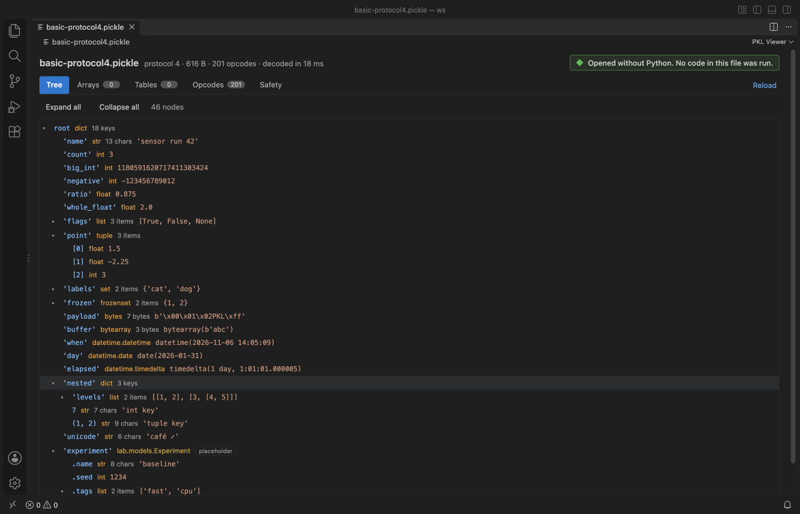
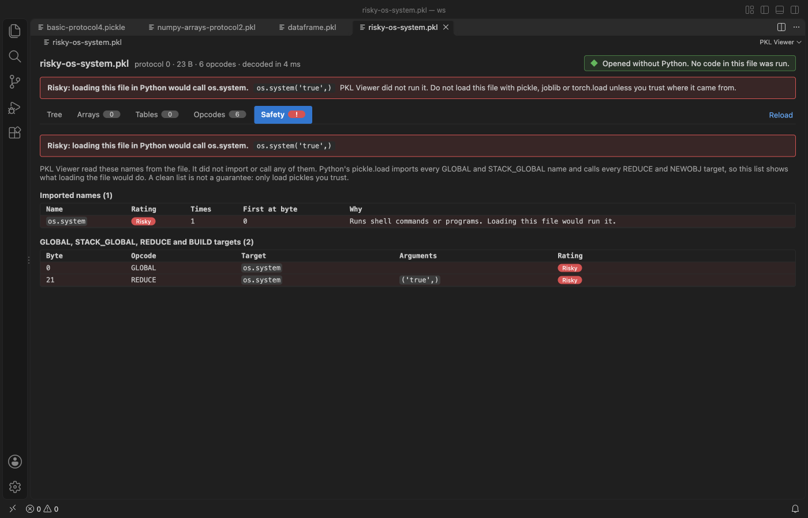
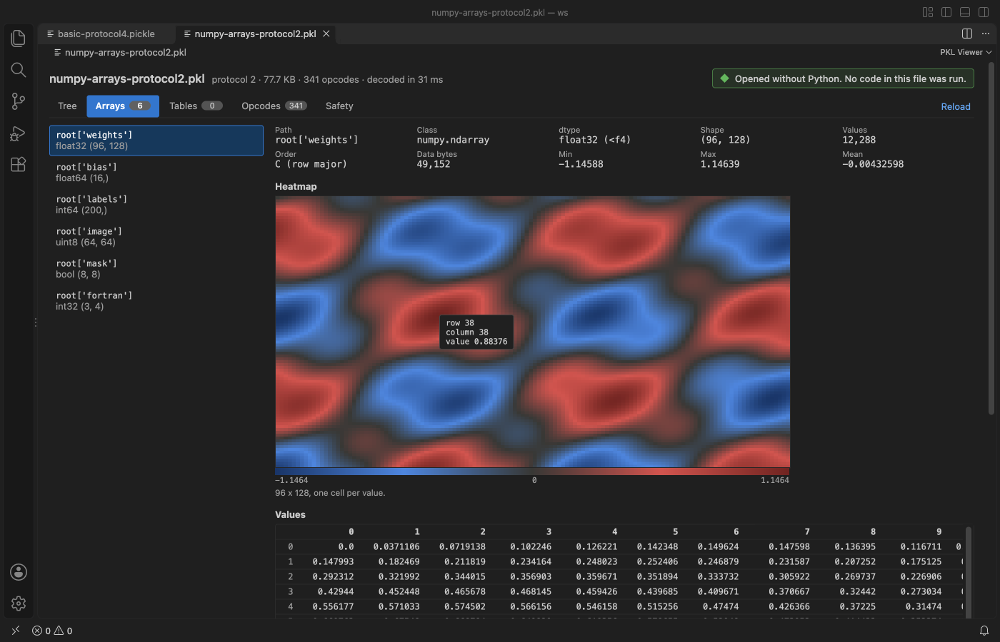
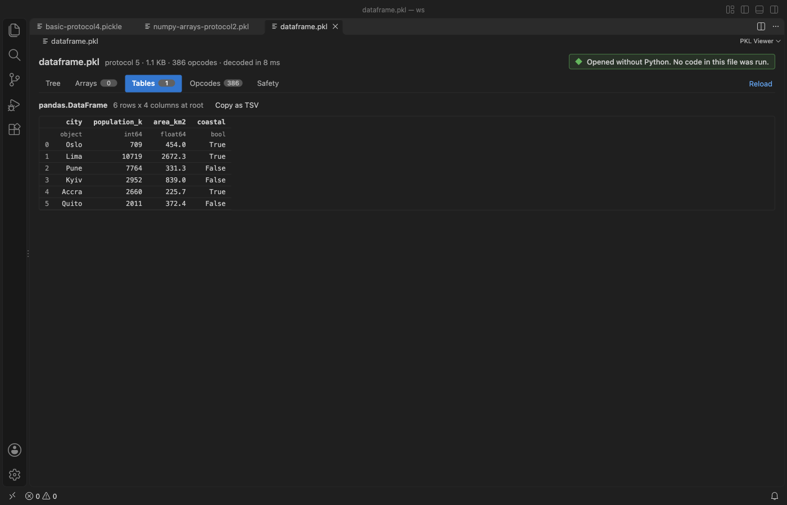

# PKL Viewer & Pickle Viewer

Open Python `.pkl`, `.pickle` and `.p` files in VS Code without Python, and see what a pickle would do before you load it.

*Screenshot of VS Code 1.142 with a sample made by `scripts/make_samples.py`.*

- Nothing runs. The file is decoded by a reader that never imports or calls anything, so a hostile pickle cannot touch your machine.
- Your data, readable: a tree with Python types, NumPy arrays with stats and a heatmap, pandas DataFrames as a table.
- A safety check that lists every name the file would import or call in Python, with risky ones like `os.system` and `builtins.eval` flagged.

## Quick start

1. Install PKL Viewer & Pickle Viewer.
2. Click a `.pkl` or `.pickle` file in the Explorer. For a `.p` file, right-click it and pick Open in PKL Viewer.

## What you see

| Tab | Shows |
|---|---|
| Tree | The decoded object with types, lengths and values. Dicts keep any key type, tuples stay tuples, and bytes, sets, datetimes and big integers keep their Python type. A class the viewer cannot rebuild shows as a placeholder named `module.Class`, with the attributes the file stores for it. |
| Arrays | NumPy arrays rebuilt from their bytes when the dtype is a plain number type: shape, dtype, order, min, max, mean, NaN count, a heatmap for 2-D and larger arrays, and a grid of the first values. |
| Tables | pandas DataFrames as a table, with column dtypes and the index, when the column blocks are plain numbers, bools or Python objects. Other column types fall back to the tree with a note. |
| Opcodes | A listing like `pickletools.dis`, with byte offsets, MARK nesting and a count of each opcode. |
| Safety | Every GLOBAL, STACK_GLOBAL, REDUCE and BUILD target, with the byte where it appears and the arguments a call gets. |

## The safety check

`pickle.load` imports every name in a GLOBAL or STACK_GLOBAL opcode and then calls the REDUCE targets. That is how a model file from the internet can run a shell command. PKL Viewer lists those names and rates each one:

| Rating | Meaning | Examples |
|---|---|---|
| Risky | Runs commands or code, or touches files or the network | `os.system`, `subprocess.Popen`, `builtins.eval`, `builtins.exec`, `socket`, `shutil` |
| Check | Helpers that attacks chain together | `builtins.getattr`-style helpers, `operator.attrgetter`, `functools.partial` |
| Needs package | A class from a package outside the standard data types | your own classes, `__main__.Model` |
| Data type | Plain data | NumPy, pandas, datetime, collections |

When a file is risky, a red banner says what it would call, for example `os.system('true',)`, and the viewer opens on the Safety tab. A clean list is not a promise that a file is safe, so only load pickles you trust.

## Formats

- Pickle protocols 0 to 5, including Python 2 strings, out-of-band buffers (shown as placeholders) and persistent ids (shown as placeholders, as in PyTorch files).
- NumPy arrays from protocol 2 (`_reconstruct`) and protocol 5 (`_frombuffer`), C or Fortran order, NumPy 1.x and 2.x names.
- pandas DataFrames in the pandas 2.x layout and the older block manager layout.

## Big files

Decoding runs in a worker thread, so VS Code stays responsive. Files over 512 MB show a message and are not read (setting `pickleViewer.maxFileMB`, up to 2048). Large containers show their first 1,000 items, the tree stops at 50,000 nodes, tables show the first 1,000 rows and the opcode listing shows the first 20,000 lines. The opcode counts and the safety check always cover the whole file.

## Settings

| Setting | Default | What it does |
|---|---|---|
| `pickleViewer.maxFileMB` | 512 | Largest file to decode. |
| `pickleViewer.askForRating` | true | Ask one time for a rating after a few days of use. |

## Privacy

PKL Viewer works offline. It makes no network calls and sends no telemetry. The webview runs under a strict Content Security Policy, and file text is always inserted as text.

## Limits

- Joblib files with compressed arrays, PyTorch `.pt` zip archives and `.npy` files are not pickles in this sense and are not opened.
- datetime64, structured and string dtypes of NumPy show in the tree and the grid, not as numbers.
- pandas Series, Categorical, nullable and Arrow columns show in the tree.
- `.p` opens by choice, not by default, because Progress ABL uses the same extension for source code.

## More viewers by Zovo

- [AGENTS.md & CLAUDE.md Linter (Context Drift)](https://marketplace.visualstudio.com/items?itemName=zovo.context-drift)
- [PDF Viewer & Reader with Dark Mode](https://marketplace.visualstudio.com/items?itemName=zovo.pdf-viewer-dark)
- [CSV Viewer, Excel Viewer & Parquet Viewer](https://marketplace.visualstudio.com/items?itemName=zovo.table-viewer-vscode)
- [DOCX Viewer & Word Viewer with Dark Mode](https://marketplace.visualstudio.com/items?itemName=zovo.docx-viewer-vscode)
- [HDF5 & NetCDF Explorer (H5 Viewer)](https://marketplace.visualstudio.com/items?itemName=zovo.hdf5-netcdf-explorer)
- [PPTX Viewer for PowerPoint Slides](https://marketplace.visualstudio.com/items?itemName=zovo.pptx-slide-viewer)
- [Agent Skills & Claude Skills (Skill Shelf)](https://marketplace.visualstudio.com/items?itemName=zovo.skill-shelf)
- [GGUF, Safetensors & NPY Tensor Viewer](https://marketplace.visualstudio.com/items?itemName=zovo.tensor-viewer)

## License

MIT. See [THIRD-PARTY-NOTICES.md](THIRD-PARTY-NOTICES.md) for the pickleparser notice.
